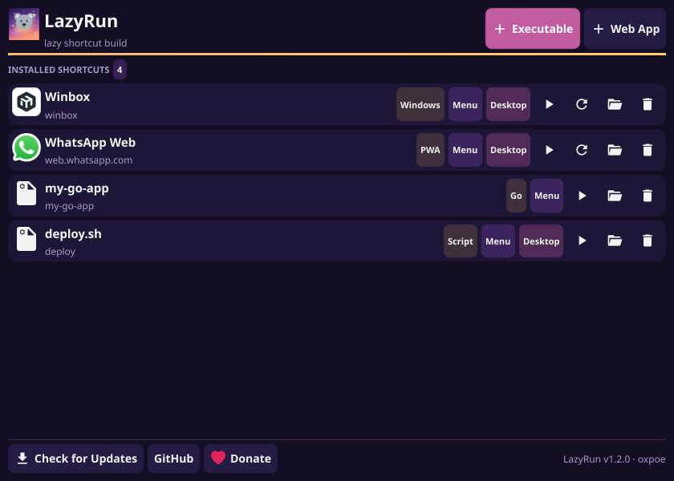
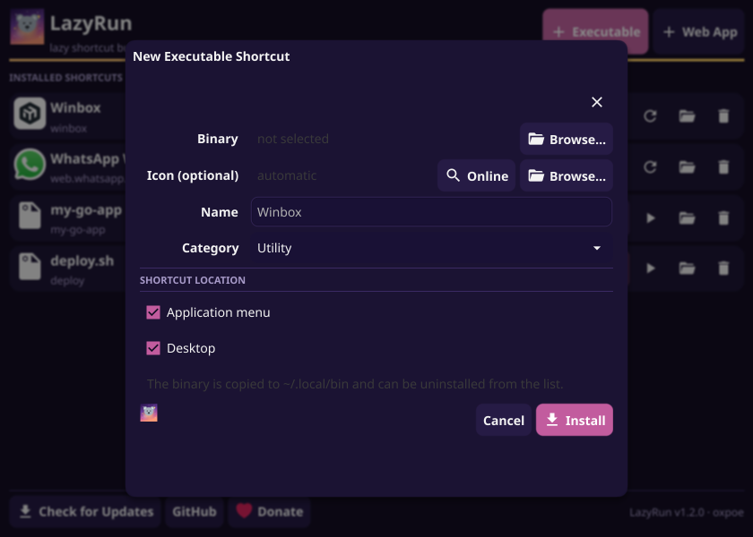
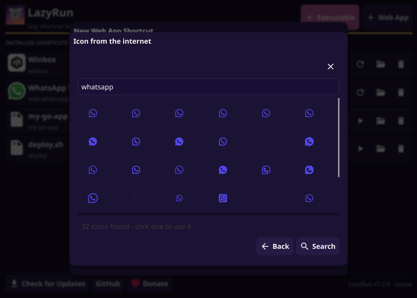
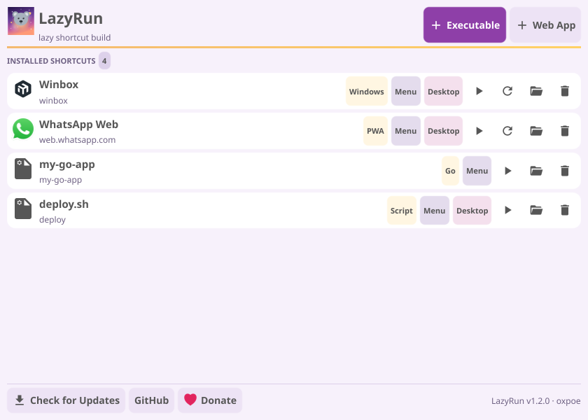

# LazyRun — lazy shortcut build

[](https://github.com/oxpoe/lazyrun/actions/workflows/ci.yml)
[](https://github.com/oxpoe/lazyrun/releases/latest)
[](LICENSE)


Desktop app (Go + Fyne) that creates application shortcuts on Linux in a few clicks:
from an executable file, or from a web URL as a PWA. Ships as a single-file
AppImage, no terminal needed.

*Dream-sky theme: night violet, dusk pink and a moon-coloured accent that subtly
breathes while the app is open (the koala in `assets/logo.svg` is the mascot).*



<p align="center">
  
  
</p>

- **Repo:** <https://github.com/oxpoe/lazyrun>
- **Donate:** <https://donasi.oxpoe.qzz.io/>

- **Executable shortcut** — picks an ELF/AppImage/script/Windows `.exe`, copies it to
  `~/.local/bin/`, installs the icon, writes the `.desktop` entry.
- **Automatic type label** — every shortcut is tagged with what it actually is,
  detected from the file: `Go`, `AppImage`, `Electron`, `Script`, `Windows`, `Binary`
  (`.exe` files are launched through `wine`), or `PWA` for web apps.
- **Web app shortcut** — opens the URL as an app: `--app=<url>` for
  Chromium-based browsers (Chrome, Chromium, Brave, Edge, Vivaldi, Helium,
  including Flatpak builds), `--new-window` for Firefox.
- **Icons** — pick a file, or search in the *Icon from the internet* dialog:
  - **app name** (`whatsapp`) → search of the [Iconify](https://iconify.design) icon library;
  - **website** (`mikrotik.com`) → the site's own icons: web app manifest (up to
    512 px), apple-touch-icon, favicon, plus a favicon service. Best option for apps
    that have no icon in icon libraries (e.g. Winbox → `mikrotik.com`);
  - **image URL** (`https://…/icon.png`) → that image directly.
  Installation also tries automatically: a nearby image file, the site's icons, then a
  brand icon matched by name. Every icon is converted to PNG (SVG, webp, gif, bmp,
  ico and jpeg included) at up to 512 px, and remembers its source so the *sync icon*
  button in the list can fetch it again later.
- **Shortcut location** — checkbox for *Application menu* and/or *Desktop*,
  at least one is required. Desktop-only entries are written with
  `NoDisplay=true` so they do not show up in the menu.
- **Manage** — list installed shortcuts, see where they live, mark entries whose
  `.desktop` file was deleted manually, uninstall (optionally removing the
  copied binary).
- **Auto refresh** — calls `update-desktop-database` and
  `kbuildsycoca6`/`kbuildsycoca5` after install/uninstall.
- **i18n** — UI in English or Indonesian, chosen from `$LANG`.
- **Self update** — AppImage with embedded zsync update information, optional
  `AppImageUpdate` integration via *Check for Updates*.
- **Desktop integration** — uses the host cursor theme (KDE/GNOME setting is
  forwarded to the toolkit when the session does not export it), live desktop
  menu refresh via `update-desktop-database` and `kbuildsycoca`.

## Install

Needs a desktop Linux with the usual GL/X11 or Wayland libraries (any KDE Plasma or
GNOME install has them). No root, nothing outside your home directory.

Download the AppImage from [Releases](https://github.com/oxpoe/lazyrun/releases), then:

```bash
chmod +x lazyrun-*-x86_64.AppImage
./lazyrun-*-x86_64.AppImage
```

Keep it wherever you like (for example `~/.local/bin/`). Automatic updates need
[AppImageUpdate](https://github.com/AppImageCommunity/AppImageUpdate) in `$PATH`.

## Usage

1. **+ Executable** or **+ Web App**.
2. Fill in the form (name and icon are pre-filled/auto-detected).
3. Pick *Application menu* and/or *Desktop*, then **Install**.

## What it writes

| Purpose | Path |
|---|---|
| Copied binary | `~/.local/bin/<name>` |
| Icon (always PNG) | `~/.local/share/icons/hicolor/512x512/apps/<name>.png` |
| Menu entry (source of truth) | `~/.local/share/applications/<name>.desktop` |
| Desktop copy | `~/Desktop/<name>.desktop` (from `xdg-user-dir DESKTOP`) |
| LazyRun metadata | `~/.config/lazyrun/shortcuts.json` |

Everything stays inside the home directory — no root, no system directories.

The UI follows your system light/dark setting:

<p align="center">
  
</p>
Filenames use a slug of the app name (`WhatsApp Web` → `whatsapp-web.desktop`);
the `Name=` field keeps the name you typed.

## Updates

LazyRun checks the **latest release** of this repository once, a few seconds after
start (only when running as an AppImage) and offers to install it:

- if [AppImageUpdate](https://github.com/AppImageCommunity/AppImageUpdate) is in
  `$PATH` it is used, so only the changed blocks are downloaded (zsync);
- otherwise the AppImage is downloaded, verified (ELF + AppImage magic bytes) and
  swapped in atomically — if anything fails the current AppImage stays untouched;
- *Restart now* in the dialog runs the new version.

*Check for Updates* in the footer runs the same flow manually.

**Publishing a release** is just a tag — GitHub Actions builds and uploads
everything (`.github/workflows/release.yml`):

```bash
git tag v1.1.0 && git push --tags
```

The workflow builds the AppImage with the version taken from the tag, runs the
tests, and publishes a release with the `.AppImage` + `.zsync` assets and
auto-generated notes. To build a release locally instead:

```bash
VERSION=1.1.0 GH_USER=oxpoe GH_REPO=lazyrun ./build.sh
```

## Build

Requirements: Go 1.24+, cgo, and X11/OpenGL development headers (Fyne).

```bash
./build.sh                # dist/lazyrun + dist/lazyrun-<version>-<arch>.AppImage
SKIP_APPIMAGE=1 ./build.sh # binary only
go test ./...             # unit + install/uninstall tests
```

`build.sh` downloads `linuxdeploy` into `dist/tools/` on first run and needs
network for the AppImage step. To embed zsync update information, set
`GH_USER` and `GH_REPO`:

```bash
GH_USER=oxpoe GH_REPO=lazyrun ./build.sh
```

## Roadmap

- Edit existing shortcuts, detect binaries in `$PATH`, optional symlink instead of a
  Desktop copy, import/export, dark mode.
- Firefox PWA via `--kiosk`, Flatpak/Snap targets, icon preview.

Known limitations are tracked as [issues](https://github.com/oxpoe/lazyrun/issues);
the main ones:

- the type label (`Go`, `Electron`, …) is detected when the shortcut is created, so a
  binary replaced by hand keeps its old label until it is reinstalled;
- the update check runs while the app is open (startup + every 4 hours), there is no
  background service, and updates are offered, never forced;
- online icon search uses Iconify plus the icons a website itself provides
  (manifest / touch icon / favicon) — there is no image-search scraping;
- `Electron` detection uses the `resources/*.asar` marker, so Chromium-based apps
  (Vivaldi, Helium, …) show up as `Binary`.

## Disclaimer / Catatan

**EN** — LazyRun is a small hobby project by **oxpoe**, made for fun and to make
daily Linux desktop life a bit simpler: turn a portable binary or a web page
into a proper application shortcut without opening a terminal. It only writes
inside your home directory, but it does copy files and create launchers: check
what you point it at, keep backups of anything irreplaceable, and use it at your
own risk. Provided "as is", without warranty of any kind. LazyRun is not
affiliated with any browser vendor or application it creates shortcuts for.

**ID** — LazyRun adalah proyek iseng **oxpoe**, dibuat untuk senang-senang dan
supaya urusan shortcut di desktop Linux jadi lebih simpel: binary portable atau
halaman web bisa jadi shortcut aplikasi tanpa buka terminal. Aplikasi ini hanya
menulis di dalam home directory, tetapi tetap menyalin file dan membuat
launcher: periksa dulu apa yang kamu pilih, backup data penting, dan gunakan
dengan risiko sendiri. Disediakan "apa adanya", tanpa jaminan apa pun. LazyRun
tidak berafiliasi dengan vendor browser atau aplikasi apa pun yang dibuatkan
shortcut-nya.

## License

MIT.
